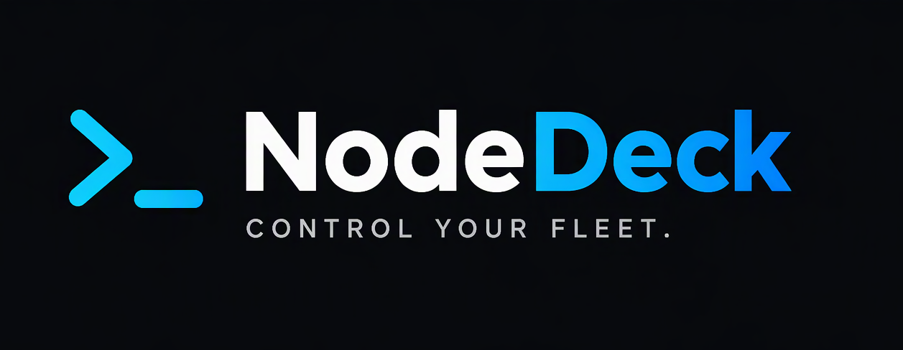

<div align="center">
  
  <h1>NodeDeck</h1>
  <p><strong>Modern Minimalist Web Terminal & SFTP Manager</strong></p>
  <p>Built with Go, xterm.js, and JetBrains Mono Nerd Font</p>
</div>

---

## ✨ Features

- **⚡ Lightweight Micro-Stack:** Single static Go binary (`creack/pty` + `gorilla/websocket`) serving assets, managing PTY sessions, and serving SFTP REST endpoints.
- **🎨 Modern Dark Aesthetic:** Clean flat dark backdrop (`#0f1115`), thin tab bar, collapsible sidebar, blue accent highlights, and bundled JetBrains Mono Nerd Font.
- **🖥️ Host Manager:** Save connection profiles (SSH, Tailscale, Local Shell) with custom badges and passwords/keys. Direct quick-connect from the dashboard.
- **📂 Built-in SFTP / File Explorer:** Browse server files, upload files via drag-and-drop, download files, create folders, and delete files directly from the collapsible sidebar.
- **🖱️ Native Terminal UX:** Direct PTY architecture with 10,000-line scrollback buffer, smooth mouse wheel scrolling, automatic highlight-to-copy, and seamless clipboard paste (`Ctrl+Shift+V` / right-click).
- **📑 Tab Management:** Dedicated `[+]` button to open tabs and explicit `(x)` button on each tab to close with mouse. Double-click tab to rename.
- **🚀 Native Starship Prompt:** Full interactive Bash login shell with Starship prompt (`hermes@node01 ~`) showing exact working directory and Git status.
- **📱 PWA (Progressive Web App):** Installable standalone desktop or mobile application with offline shell, custom icons, and web app manifest.
- **📖 Built-in Help:** Type `nodedeck`, `-help`, `--help`, or `help-nodedeck` directly in the terminal for quick keyboard shortcuts and features guide.

---

## 🚀 Quick Start

### 1. Clone repository
```bash
git clone git@github.com:kuhaniff/NodeDeck.git
cd NodeDeck
```

### 2. Configure environment (optional)
```bash
cp .env.example .env
```

### 3. Run with Docker Compose
```bash
docker compose up -d --build
```

### 4. Access
Open your browser and navigate to:
```
http://127.0.0.1:8090
```
Or your configured Cloudflare Access / reverse proxy domain.

---

## 🔒 Security

> [!WARNING]
> Never expose NodeDeck directly to the public internet without authentication and TLS.

- **Localhost Bound by Default:** Published on `127.0.0.1:8090` to prevent unintended LAN/WAN exposure.
- **Strict Origin Checking:** WebSocket handshake enforces Host-to-Origin matching to prevent Cross-Site WebSocket Hijacking (CSWSH).
- **Filesystem Blocklist:** Access to private SSH keys (`id_*`, `*.pem`, `*.key`), `/etc/shadow`, `/etc/sudoers`, and `/var/run/docker.sock` via SFTP REST API is strictly forbidden (`403 Forbidden`).
- **Reverse Proxy / Cloudflare Tunnel:** When exposing remotely, route through an HTTPS reverse proxy or Cloudflare Access tunnel with authentication.
- **Opt-in Sudo:** Container runs unprivileged by default; passwordless sudo is disabled unless explicitly enabled via `ENABLE_SUDO=true`.

---

## ⚙️ Environment Variables

| Variable | Default | Description |
| :--- | :--- | :--- |
| `NODEDECK_BIND_IP` | `127.0.0.1` | Host interface IP to bind port |
| `NODEDECK_PORT` | `8090` | Host port to publish |
| `PUID` | `1001` | User ID inside the container |
| `PGID` | `1001` | Group ID inside the container |
| `USER_NAME` | `hermes` | Shell username |
| `ENABLE_SUDO` | `false` | Enable passwordless sudo for user |
| `STACKS_DIR` | `/home/aneep/stacks` | Host directory mounted to `/home/aneep/stacks` |

---

## ⌨️ Shortcuts & Controls

| Action | Control / Shortcut |
| :--- | :--- |
| **Toggle Sidebar** | Click menu icon `☰` or press `Alt` + `b` |
| **New Tab** | Click `[+]` button or press `Alt` + `t` |
| **Close Tab** | Click `(x)` on tab or press `Alt` + `w` |
| **Close Shell** | Type `exit` or press `Ctrl` + `d` |
| **Rename Tab** | Double-click on tab title |
| **Switch Tab** | Click tab or press `Alt` + `1` .. `Alt` + `9` |
| **Next / Prev Tab** | `Alt` + `Right` / `Alt` + `Left` |
| **Copy Text** | Select / highlight text (automatically copied to clipboard) |
| **Paste Text** | `Ctrl` + `Shift` + `v` or mouse right-click |
| **Install PWA** | Click `Install` on the right side of the tab bar |
| **CLI Help** | Type `nodedeck` or `-help` in terminal |

---

## 🛠️ Stack Structure

```
nodedeck/
├── Dockerfile              # Multi-stage build (Go builder + minimal Debian 13 runtime)
├── compose.yaml            # Docker Compose service definition
├── entrypoint.sh           # User permissions and container entrypoint
├── main.go                 # Go WebSocket server + PTY bridge + SFTP REST API
├── go.mod / go.sum         # Go dependencies (creack/pty, gorilla/websocket)
├── data/                   # Persistent runtime data
│   └── hosts.json          # Connection host profiles
├── static/                 # Static web assets
│   ├── index.html          # Web terminal UI + sidebar + SFTP explorer
│   ├── style.css           # Modern dark styling, sidebar & tab bar
│   ├── app.js              # Tab management, host manager, SFTP & xterm.js orchestration
│   ├── manifest.json       # PWA manifest
│   ├── sw.js               # PWA service worker
│   ├── favicon.svg         # App SVG icon
│   ├── icon-192.png        # PWA 192px icon
│   ├── icon-512.png        # PWA 512px icon
│   └── vendor/             # Vendored xterm.js, addons & JetBrains Mono Nerd Font
├── LICENSE                 # MIT License
└── README.md
```

---

## 📄 License
MIT
